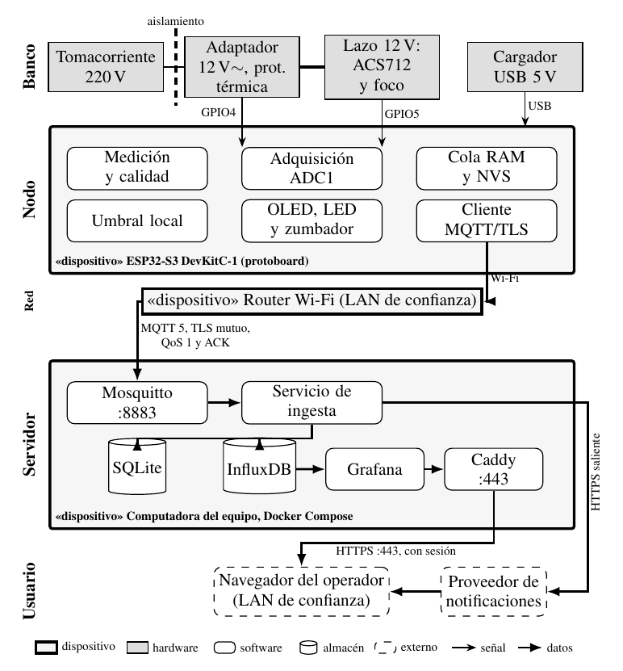
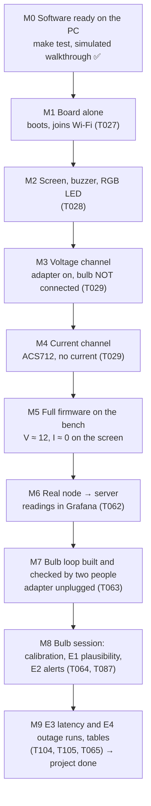
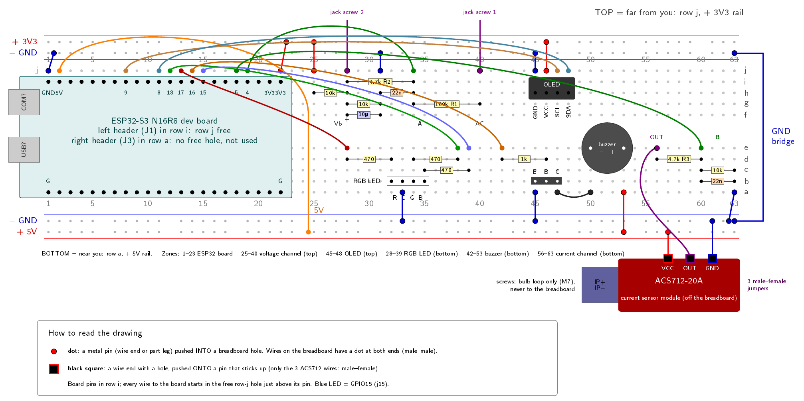
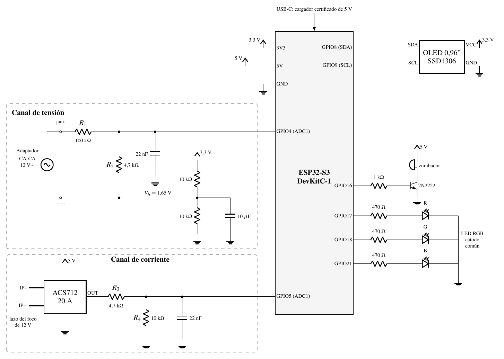

# Hardware and integration roadmap (step by step, for first-time builders)

This guide takes you from a bag of parts to the finished project: the ESP32 node on
the breadboard, measuring the 12 V bulb loop, sending its readings to the server,
and passing the final end-to-end tests. It is written for someone who has never
built a circuit: every part is explained, every connection is listed, and every
step ends with a **test gate** that proves the step works before you add the next
one.

- The exact wiring and the pass values come from the Spanish bench guide
  [`build-guide.md`](build-guide.md) (section numbers are given as "BG §n"). If the
  two ever disagree, the build guide and `specs/001-energy-monitoring-system/plan.md`
  win; tell the team so this guide gets fixed.
- Task numbers (T027, T062, …) are from `specs/001-energy-monitoring-system/tasks.md`.
- All readings are **not validated**: there is no reference meter.
- No OLED or AC-AC adapter yet? From M2 on, follow the reduced-kit version
  [`integration-roadmap-no-oled-no-adapter.md`](integration-roadmap-no-oled-no-adapter.md),
  which keeps the same holes and adds each part later.

## Contents

1. [The big picture](#1-the-big-picture)
2. [Safety rules (read first)](#2-safety-rules-read-first)
3. [Know your parts](#3-know-your-parts)
4. [Breadboard and board basics](#4-breadboard-and-board-basics)
5. [Software you need on the PC](#5-software-you-need-on-the-pc)
6. [M1: the board alone](#m1-the-board-alone-stage-1-t027)
7. [M2: screen, buzzer and LED](#m2-screen-buzzer-and-led-stage-2-t028)
8. [M3: voltage channel](#m3-voltage-channel-stage-3-t029)
9. [M4: current channel, no current](#m4-current-channel-with-no-current-stage-4-t029)
10. [M5: full firmware on the bench](#m5-full-firmware-on-the-bench-integration-1)
11. [M6: real node to the server](#m6-the-real-node-talks-to-the-server-integration-2-t062)
12. [M7: build and check the bulb loop](#m7-build-and-check-the-bulb-loop-stage-5-t063)
13. [M8: bulb session](#m8-bulb-session-calibration-e1-and-e2-stage-6-t064-t087)
14. [M9: performance runs and the final end-to-end](#m9-performance-runs-and-the-final-end-to-end-t104-t105-t065)
15. [Progress checklist](#progress-checklist)

---

## 1. The big picture



*Figure 1. The whole system (article Fig. 1). Only the certified adapter touches
220 V; everything you build is low voltage.*

Three things are built separately and then joined:

- **Hardware** on a breadboard (this guide, M1–M4, M7).
- **Firmware** for the ESP32. It is already written and tested on the PC
  (`make firmware-test`).
- **Server** (Docker: broker, ingestion, databases, Grafana). It is already
  working with simulated data; you have exercised it in
  `guides/operations/e2e-walkthrough.md`.

The roadmap joins them one piece at a time. Each milestone has a test gate; do not
start the next milestone until the gate passes.



| Milestone | Needs the bulb? | Time (first time) | Proves |
|---|---|---|---|
| M1 | no | 1–2 h | The board, the toolchain, Wi-Fi |
| M2 | no | 1–2 h | The local warning hardware (screen, buzzer, LED) |
| M3 | no | 1 h | The voltage measurement circuit |
| M4 | no | 45 min | The current sensor and its circuit |
| M5 | no | 30 min | The real measuring firmware on the real circuit |
| M6 | no | 1–2 h | The whole data path: board → broker → databases → dashboard |
| M7 | yes (built, not on) | 45 min | The high-current loop is built safely |
| M8 | yes | 2–3 h | Calibration, plausibility (E1) and alerts (E2) |
| M9 | yes | 1–2 days | Latency (E3) and outage recovery (E4); results for the article |

---

## 2. Safety rules (read first)

The project is low voltage: the only thing that ever touches 220 V is a certified
plug-in adapter, which turns it into 12 V AC. Still, follow these rules every time
(BG §2):

1. **Never open, cut or modify the adapter** or its 220 V side. Do not use it if
   it is damaged, hot or uncertified.
2. **Unplug before you rewire.** Unplug the adapter from the wall (and the board
   from USB) before changing any connection.
3. **The bulb current never goes through the breadboard or jumper wires.** The
   bulb loop carries about 1.7 A: it uses household wire and crocodile clips only.
4. **No bare metal touching bare metal.** If anything gets hot or smells, unplug.
5. **The halogen bulb gets very hot.** Do not touch it on or just after; place it
   on a non-flammable surface, away from the breadboard.
6. **Never put more than 3.3 V on an ESP32 pin.** The measurement circuits exist
   to keep the signals between 0 and 3.3 V; do not feed the pins from anything
   else.
7. **The board is powered only by the USB cable from the PC.** The 12 V AC adapter
   never connects to the ESP32 board in any way.
8. **Stop** if a part is damaged, gets warm, or does not match the parts list.
   Write it down.

---

## 3. Know your parts

Full list with quantities: BG §3. Here is how to recognise each part and which
way round it goes.

| Part | What it does here | How to recognise it | Which way round |
|---|---|---|---|
| ESP32-S3 N16R8 dev board | The computer: measures, decides, sends | DevKitC-1-compatible board (VCC-GND YD-ESP32-S3 style): metal-covered **ESP32-S3-WROOM-1-N16R8** module (16 MB flash, 8 MB PSRAM), CH343 USB chip, **two USB-C ports** printed **COM** and **USB**; sits on the breadboard | Use the **COM** port (on Espressif's own board: **UART**) for flashing and the serial console |
| Jumper wires | Connect everything | Male-male (pin at both ends) and **male-female** (pin at one end, a hole at the other) | Male-male for everything on the breadboard (about 25); male-female only for the 3 ACS712 pins |
| Breadboard (830 points) | Holds the circuit without soldering | White board with holes | See section 4 |
| Resistors | Limit current, divide voltages | Small beige/blue cylinders with colour bands | Any way round |
| 10 µF electrolytic capacitor | Keeps the 1.65 V reference steady | Small can with a **stripe** down one side | **Polarised**: long leg = **+**, stripe side = **−** (to GND) |
| 22 nF ceramic capacitors (×2) | Filter noise before the ADC | Small yellow/orange drop marked **223** | Any way round |
| 2N2222 transistor | Switch that lets a 3.3 V pin drive the 5 V buzzer | Black half-cylinder (TO-92), 3 legs | Middle leg = **base**. Outer legs differ by version (see below) |
| Active buzzer, 5 V | The alarm sound | Small black cylinder, sealed bottom, often a "+" or a sticker | Long leg / "+" = **+** (to 5 V) |
| RGB LED, common cathode (assumed) | Status colour | Clear/milky LED with **4 legs** | **Longest leg = common cathode** (to GND) |
| OLED 0.96" SSD1306 I²C (assumed) | Status screen | Small screen with **4 pins**: GND, VCC, SCL, SDA | Read the labels: GND/VCC order varies by maker |
| ACS712-20A module | Measures the bulb current, isolated | Small red/blue board with a 2-screw terminal (IP+, IP−) and 3 pins (VCC, OUT, GND) | Pins read on the board |
| 12 V AC adapter | Powers the bulb loop and is the voltage being measured | Plug-in transformer; output marked **12 V ~** or "AC" | Never into a DC input |
| DC jack with screw terminal | Connects the adapter plug to wires | Female barrel socket with 2 screws | Either screw is fine (AC) |
| G4 halogen bulb 12 V 20 W | The load we monitor | Small capsule bulb with two thin pins | Either way (AC) |

**Resistor colour bands** (4-band, 5 %: the 4th band is gold; 5-band, 1 %: the
last band is brown):

| Value | Used as | 4-band colours | 5-band colours |
|---|---|---|---|
| 100 kΩ | R1 (voltage divider) | brown, black, yellow, gold | brown, black, black, orange, brown |
| 4.7 kΩ | R2, R3 | yellow, violet, red, gold | yellow, violet, black, brown, brown |
| 10 kΩ | Vb (×2), R4 | brown, black, orange, gold | brown, black, black, red, brown |
| 470 Ω | RGB LED (×3) | yellow, violet, brown, gold | yellow, violet, black, black, brown |
| 1 kΩ | Transistor base | brown, black, red, gold | brown, black, black, brown, brown |

If a band is hard to read, a basic multimeter on Ω settles it (optional).

**2N2222 leg order.** Hold it with the **flat face towards you** and legs down. The
base is always the middle leg. The outer legs depend on the version printed on it:
**PN2222A: E-B-C** (emitter left); **P2N2222A: C-B-E** (collector left). Read the
marking and check its datasheet before wiring (BG §6).

---

## 4. Breadboard and board basics

### How a breadboard connects

```
   + rail  ─────────────────────────────────────  (all holes in a rail line are joined)
   − rail  ─────────────────────────────────────
           1   2   3   4   5   6   7  ...  63
       j   o   o   o   o   o   o   o
       i   o   o   o   o   o   o   o     each numbered COLUMN of 5 holes
       h   o   o   o   o   o   o   o     (f–j) is joined; same for a–e
       g   o   o   o   o   o   o   o
       f   o   o   o   o   o   o   o
          ───────── centre gap (NOT joined) ─────────
       e   o   o   o   o   o   o   o
       d   o   o   o   o   o   o   o
       c   o   o   o   o   o   o   o
       b   o   o   o   o   o   o   o
       a   o   o   o   o   o   o   o
   + rail  ─────────────────────────────────────
   − rail  ─────────────────────────────────────
```

- Two parts are connected when their legs are in the **same 5-hole column** (same
  side of the gap) or in the **same rail line**.
- Some long breadboards split each rail in the middle. If yours has a gap in the
  printed red/blue line, bridge the halves with a short jumper.

### Power rails plan (use it for the whole project)

| Rail | Connect to board pin | Used by |
|---|---|---|
| Top **+** | **3V3** | Vb divider, OLED |
| Top **−** | **GND** | everything |
| Bottom **+** | **5V** | ACS712, buzzer |
| Bottom **−** | **GND** (jumper to the top − rail) | everything |

Never join a 3V3 rail to a 5V rail. Label the rails with tape ("3V3", "5V").

### The ESP32-S3 N16R8 dev board on the breadboard

The dev board goes **straight into the breadboard**, at its left end. (The GPIO
extension board from the kit is not used.)

**Its pins** (seen from above, module at the top, USB-C ports at the bottom; the
labels are printed beside the pins):

```
   left header (J1)                 right header (J3)
   3V3   ← 3V3 rail (top +)         GND
   3V3                              TX     ×
   RST                              RX     ×
   4     ← voltage signal A         1
   5     ← current signal B         2
   6                                42
   7                                41
   15    → LED blue (470 Ω)         40
   16    → buzzer (via 1 kΩ)        39
   17    → LED red (470 Ω)          38
   18    → LED green (470 Ω)        37     ×
   8     ↔ OLED SDA                 36     ×
   3     ×                          35     ×
   46    ×                          0      ×
   9     → OLED SCL                 45     ×
   10                               48     × (on-board RGB LED)
   11                               47
   12                               21
   13                               20     ×
   14                               19     ×
   5V    ← 5V rail (bottom +)       GND
   GND   ← GND rails                GND
         [COM]  [USB]   ← USB-C ports (read the print; use COM)
```

**Every pin the project uses is on the left header.** The right header is not
wired at all.

**Pins marked × must never be connected:**

| Pins | Why |
|---|---|
| 35, 36, 37 | used inside the module by the 8 MB PSRAM (N16R8) |
| 0, 3, 45, 46 | boot-mode pins: a wire here can stop the board from starting or flashing |
| TX, RX | the serial console, already used through the COM port |
| 19, 20 | the native USB port |
| 48 | the board's own small RGB LED |

The firmware uses none of them; `firmware/main/board.h` refuses to build if a pin
is moved onto a PSRAM, boot or native-USB pin. (The blue LED is on GPIO15, not
GPIO21, since 2026-11-26: GPIO21 is on the right header, which has no free hole
on the breadboard.)

### Breadboard layout plan (one standard 830-point breadboard)

Everything low-voltage fits on **one** breadboard. Each part has a fixed place,
so the board stays tidy and every milestone only **adds** parts: nothing built
earlier has to move. The milestones below give the exact holes; this section is
the overview.



*Figure 2. Where every part and jumper goes, seen from above: **row j at the top**
(far from you), **row a at the bottom** (near you), column 1 on the left. The row
letters are repeated on the right edge, because the dev board covers them on the
left. Coloured lines are jumpers, yellow boxes are
resistors. The dev board sits in columns 1–22; each jumper to it starts in the
free row-j hole above its pin. A **dot** is a metal pin pushed into a hole; a
**black square** is a wire end with a hole, pushed onto a pin (only the three
ACS712 wires). The ACS712 current sensor (red module, bottom right) and the jack
(top, "jack screw 1/2") sit off the breadboard and arrive by jumpers.*

**How holes are named.** A hole is a row letter plus a column number, as printed
on the breadboard: **h28** = row h, column 28.

**Put the breadboard in front of you like this** (same as Figure 2):

```
            far from you (TOP)
   + rail   red line   → 3V3
   − rail   blue line  → GND
   row j  ·  ·  ·  ·  ·  ·  ·   ← row j is at the TOP
   row i  ·  ·  ·  ·  ·  ·  ·
   ...
   row f  ·  ·  ·  ·  ·  ·  ·
   ─────── centre gap ───────
   row e  ·  ·  ·  ·  ·  ·  ·
   ...
   row a  ·  ·  ·  ·  ·  ·  ·   ← row a is at the BOTTOM
   − rail   blue line  → GND
   + rail   red line   → 5V
            near you (BOTTOM)
          1  2  3  ...  63      ← column 1 on the LEFT
```

If your breadboard ends up with column 1 on the right when row j is at the top,
it is printed the other way: tell the team before wiring.

**Zones** (keep each group of parts inside its zone):

| Columns | Half | What goes there | Built in |
|---|---|---|---|
| 1–23 | both | ESP32-S3 dev board | M2 |
| 25–40 | top (f–j) | voltage channel (Vb, R1, R2, 10 µF, 22 nF) | M3 |
| 45–48 | top | OLED screen | M2 |
| 28–39 | bottom (a–e) | RGB LED and its three 470 Ω | M2 |
| 42–53 | bottom | buzzer, 2N2222 and 1 kΩ | M2 |
| 56–63 | bottom | current channel (R3, R4, 22 nF) | M4 |

The top half sits next to the **3V3** rail and the bottom half next to the
**5V** rail, so each part is near the supply it needs.

#### Seating the ESP32-S3 board

1. Turn the board so its two **USB-C ports point left**, out past the end of the
   breadboard (column 1 side). The left header (3V3 … 5V, GND) is now the **far**
   one (row j side); the right header is the near one.
2. Line up the far header with **row i**: its **GND** pin (next to the USB ports)
   in **i1**, **5V** in **i2**, and so on, up to **3V3** in **i22**. The near
   header falls into **row a**. (Its pins are about 10 holes apart, measured on
   the photo of your board.)
3. Press down gently with both thumbs, evenly along the board, until the pins are
   fully in. Do not rock it from one end.
4. **Check the labels** printed next to the pins against the table below.
5. Check that **row j** is free above every far-header pin. That free hole is
   where each jumper to the board goes, because the five holes f–j of a column are
   joined to the pin in row i.

The board covers rows i–j in columns 1–22, so nothing else goes there.

**Free hole for each board pin used** (column = 23 − position from the 3V3 end):

| Board pin | Column | Jumper goes in | Used for | Built in |
|---|---|---|---|---|
| GND | 1 | **j1** | top − rail | M2 |
| 5V | 2 | **j2** | bottom + rail | M2 |
| 9 | 8 | **j8** | OLED SCL | M2 |
| 8 | 11 | **j11** | OLED SDA | M2 |
| 18 | 12 | **j12** | LED green | M2 |
| 17 | 13 | **j13** | LED red | M2 |
| 16 | 14 | **j14** | buzzer (via 1 kΩ) | M2 |
| 15 | 15 | **j15** | LED blue | M2 |
| 5 | 18 | **j18** | current signal B | M4 |
| 4 | 19 | **j19** | voltage signal A | M3 |
| 3V3 | 22 | **j22** | top + rail | M2 |

All jumpers on the breadboard are **male-male** (a metal pin at both ends).

#### Rails

1. Find the printed **red** (+) and **blue** (−) lines along each rail pair. The
   figure draws + outermost at the top and − above + at the bottom; if yours is
   the other way, follow the colours, not the figure.
2. Stick tape labels: top **+** = "3V3", bottom **+** = "5V", both **−** = "GND".
3. Four power jumpers (all built in M2, step 2.0):

| Jumper | From | To |
|---|---|---|
| 3V3 | j22 | top + rail (above column 22) |
| GND | j1 | top − rail (above column 1) |
| 5V | j2 | bottom + rail: a long jumper laid flat across the board, or around its right end at column 24 |
| GND bridge | top − rail, right end | bottom − rail, right end |

#### Tidy-wiring tips

- Use short jumpers that lie flat; long loops get caught and
  pulled out.
- If your kit has colours, use red for 3V3/5V, black or blue for GND, and
  another colour for each signal. Same colour, same job.
- Bend resistor legs at 90° and push them fully in; the body lies flat a few mm
  above the holes. Do not cut legs: the parts may be reused.
- Each hole takes one leg or jumper. If a planned hole is already taken, use
  another free hole of the **same column on the same half**: it is the same
  connection.
- After each step, take a photo from above. It helps when comparing with the
  figure and when asking the team for help.

### The power-on check (do it every time before plugging USB)

1. Nothing is plugged in (USB and adapter).
2. No jumper joins a + rail to a − rail, or the 3V3 rail to the 5V rail.
3. Polarised parts the right way: the electrolytic stripe goes to GND, buzzer +
   goes to 5V, and the LED's long leg goes to GND.
4. No bare leads touching each other.

---

## 5. Software you need on the PC

| Tool | Check it works | Notes |
|---|---|---|
| Project stack | `make test` passes | Already done (M0) |
| ESP-IDF 5.4 | `. $HOME/esp/esp-idf-v5.4.4/export.sh && idf.py --version` | Path from the Makefile (`IDF_PATH`) |
| Firmware builds | `make firmware-build` and `make firmware-build-bringup` | No board needed |
| USB access | `ls /dev/ttyUSB* /dev/ttyACM*` after plugging the board | If "permission denied": `sudo usermod -aG dialout $USER`, then log out and in |

**Flash-and-watch pattern** (used in every milestone):

```
. $HOME/esp/esp-idf-v5.4.4/export.sh          # once per terminal
idf.py -C <app folder> -p /dev/ttyUSB0 flash monitor
```

Exit the monitor with **Ctrl-]**.

**Which port is yours.** It depends on the USB chip on the dev board. Plug the
board in and run `ls /dev/ttyACM* ; ls /dev/ttyUSB*` (two separate commands: in
zsh a single `ls` aborts when one pattern finds nothing).

- CP2102/CH340 chip: `/dev/ttyUSB0`, as the commands in this guide show.
- **CH343 chip** (`lsusb` shows `1a86:55d3 QinHeng … USB Single Serial`, the team's
  board): **`/dev/ttyACM0`**. Use `-p /dev/ttyACM0` everywhere this guide writes
  `/dev/ttyUSB0`, including `--port` for `provision-node.py`.

---

## M1: the board alone (stage 1, T027)

**Goal:** the board boots, takes its credentials, and joins Wi-Fi. No breadboard yet.
Wiring and pass rules: BG §5.

**You need:** the board, a USB-C data cable (some cables only charge), your PC,
and a 2.4 GHz Wi-Fi network (the ESP32 does not do 5 GHz).

### Prepare the node's credentials (once, on the PC)

1. The node certificate already exists: `infrastructure/secrets/node-node-001.crt`
   and `.key` (from `make dev-certs`).
2. Find your PC's address on the Wi-Fi network: `ip -4 addr` (for example
   `192.168.1.50`; the examples below use that). Ask the router to always give the
   PC this address (DHCP reservation), because the board will remember it.
3. Create the git-ignored file `infrastructure/secrets/secrets.local.node-node-001.json`:

   ```json
   {"node_id": "node-001", "wifi_ssid": "<your 2.4 GHz network>",
    "wifi_password": "<its password>", "mqtt_host": "192.168.1.50", "mqtt_port": 8883}
   ```

   Never put these values anywhere tracked, or in screenshots.

### Steps

1. With a USB-C data cable, connect the board's **COM** port (on Espressif's own
   board: **UART**) to the PC. A power LED lights.
2. Flash the stage 1 app:
   `idf.py -C firmware/bringup/stage1_board -p /dev/ttyUSB0 flash monitor`
3. On first boot it waits for provisioning. In a **second terminal**:
   `uv run --project services/ingestion python scripts/provision-node.py --node-id node-001 --port /dev/ttyUSB0`
   (close the monitor first if the port is busy, then reopen it with
   `idf.py -p /dev/ttyUSB0 monitor`).
4. Note: this first provisioning writes a one-time encryption key into the chip
   (eFuse). It is permanent and harmless, but it means this board is now "the
   project's board".

### Test gate M1

- [x] Monitor shows `PASS boot (ESP32-S3, stage 1 bring-up)`
- [x] Monitor shows `PASS Wi-Fi joined, IP …`
- [x] Unplug and replug: it joins Wi-Fi again without asking for credentials

Passed 2026-11-26 (bench log E-001, `experiments/bench-log.md`).

If it fails: BG §11 ("El ESP32-S3 no arranca", "El Wi-Fi no se conecta").

---

## M2: screen, buzzer and LED (stage 2, T028)

**Goal:** the three local warning parts work. Add **one at a time**, test, unplug,
then add the next (BG §6). Unplug USB before every change.



*Figure 3. The complete low-voltage circuit (article Fig. 2). M2 builds the right
side (OLED, buzzer, RGB LED); M3 and M4 build the two channels on the left.*

### Step 2.0: board and rails

1. Seat the board in columns 1–22 with its far header in row i, as in
   [Seating the ESP32-S3 board](#seating-the-esp32-s3-board).
2. Add the four power jumpers from [Rails](#rails): **j22 → top +** (3V3),
   **j1 → top −** (GND), **j2 → bottom +** (5V), and the **GND bridge** between
   the two − rails at the right end. All four are male-male (a pin at both ends).
3. Do the power-on check (section 4). Then connect the board's **COM** port to
   your **PC** with a USB-C data cable (not a phone charger) for 5 seconds. This
   only tests that the rail jumpers cause no short: the board's small red power
   LED lights and nothing gets warm. Unplug. If the LED stays off or anything heats
   up, check the four jumpers before going on.

### Step 2.1: OLED (GPIO8 / GPIO9), top half, columns 45–48

1. Push the screen's 4 header pins into **h45, h46, h47, h48**, screen facing
   you. Each pin now owns its column (holes f–j of that column).
2. Read the label of each pin on the screen. The figure assumes GND, VCC, SCL, SDA
   from left to right; if yours differ, follow **your** labels, not the column
   numbers.
3. Jumpers into the free **row j** hole of each column:

| Screen pin (column if ordered as in the figure) | From | Into hole |
|---|---|---|
| GND (45) | top − rail (M-M) | j45 |
| VCC (46) | top + rail, **3V3**, never 5V (M-M) | j46 |
| SCL (47) | **j8** (GPIO9) | j47 |
| SDA (48) | **j11** (GPIO8) | j48 |

Check the pin labels on the screen itself. A 7-pin screen is SPI, not I²C: stop and
tell the team (BG §6).

### Step 2.2: buzzer through the transistor (GPIO16), bottom half, columns 42–53

```
 GPIO16 ──[1 kΩ]── B (2N2222)        5V rail ──(+) BUZZER (−)── C (2N2222)
                   E ── − rail
```

1. **Transistor** in **b45, b46, b47**, flat face towards you. Left to right it
   must read **E, B, C** (emitter, base, collector).
   - PN2222A (E-B-C): flat face towards you.
   - P2N2222A (C-B-E): turn it round, flat face **away** from you, so that
     left to right is again E, B, C.
2. **1 kΩ** from **d42** to **d46**: d46 shares column 46 with the base.
3. Jumper **j14** (GPIO16) → **e42**.
4. Jumper **a45** (emitter column) → bottom − rail.
5. **Buzzer**: − leg in **e50**, + leg (long, "+" mark) in **e53**. If the legs
   are not 3 holes apart, keep − in e50 and put + in the nearest hole of row e.
   The buzzer body sits over rows e–h; leave rows b–j of those columns free.
6. Jumper **a47** (collector column) → **a50** (buzzer −).
7. Jumper **a53** (buzzer +) → bottom + rail (**5V**).

| From | To | Holes |
|---|---|---|
| GPIO16 | one end of the 1 kΩ resistor | j14 → e42, 1 kΩ d42–d46 |
| other end of 1 kΩ | transistor **base** (middle leg) | column 46 |
| transistor **emitter** | − rail | a45 → rail |
| transistor **collector** | buzzer **−** | a47 → a50 |
| buzzer **+** (long leg) | **5V** rail (bottom +) | a53 → rail |

Why the transistor: a GPIO gives 3.3 V and very little current; the transistor
lets it switch the 5 V buzzer. **Never** wire the buzzer straight to a GPIO.

### Step 2.3: RGB LED (GPIO17 / 18 / 15), bottom half, columns 28–39

```
 GPIO17 ──[470 Ω]── R ┐
 GPIO18 ──[470 Ω]── G ├─ LED ── common (longest leg) ── − rail
 GPIO15 ──[470 Ω]── B ┘
```

Each colour leg gets **its own** 470 Ω resistor. The typical leg order is R,
common, G, B (common is the longest), but check your LED.

1. LED legs in **b32 (R), b33 (common, longest), b34 (G), b35 (B)**, four
   neighbouring columns. If your LED's order differs, keep the common leg in
   column 33 and move the resistors to match.
2. Jumper **a33** → bottom − rail.
3. Resistors, 470 Ω each:
   - red: **d28 – d32**;
   - green: **d34 – d38**;
   - blue: **c35 – c39** (one row lower, so it can cross the green one).
4. Jumpers from the board:
   - **j13** (GPIO17) → **e28**;
   - **j12** (GPIO18) → **e38**;
   - **j15** (GPIO15) → **e39**.

### Flash and test

`idf.py -C firmware/bringup/stage2_peripherals -p /dev/ttyUSB0 flash monitor`

### Test gate M2

- [ ] Monitor shows `I2C device at 0x3C` (or 0x3D) and `PASS OLED text written`; the
      text is readable on the screen. (An offset or garbled image suggests an
      SH1106: set `OLED_COLUMN_OFFSET` to 2, BG §6.)
- [ ] The buzzer beeps once for 200 ms and is silent otherwise
- [ ] The LED shows red, green, blue one at a time. If nothing lights, your LED may
      be common anode: stop and tell the team (it changes wiring and firmware)

---

## M3: voltage channel (stage 3, T029)

**Goal:** the ESP32 sees the adapter's 12 V AC as a small wave centred at 1.65 V on
GPIO4. The bulb is **not** connected. Wiring and pass values: BG §7.

### What the circuit does (in plain words)

- The ADC can only read 0–3.3 V, and AC goes positive and negative.
- **Vb = 1.65 V** (two 10 kΩ from 3V3 to GND, with 10 µF to keep it steady) is a
  middle reference: the AC wave is lifted to swing around 1.65 V instead of 0 V.
- **R1 (100 kΩ) and R2 (4.7 kΩ)** shrink the ±17 V peaks of 12 V AC to about
  ±0.76 V, so point A swings about 0.9–2.4 V: safely inside 0–3.3 V.
- **22 nF** at A filters high-frequency noise.

```
 jack screw 1 ──[R1 100 kΩ]──●── A ──────────────► GPIO4
                             │   │
                         [R2 4.7 kΩ]  [22 nF]── − rail
                             │
 jack screw 2 ───────────────●── Vb (1.65 V)
                             │
        3V3 rail ──[10 kΩ]───●───[10 kΩ]── − rail
                             │
                          (+)10 µF(−) ── − rail
```

### Steps (adapter **unplugged** from the wall the whole time)

All in the **top half**, columns 25–40. Five columns get a name:

| Column | Name | What it is |
|---|---|---|
| 25 | 3V3 tap | brings 3V3 down from the rail |
| 28 | **Vb** | the 1.65 V middle point |
| 31 | GND tap | brings GND down from the rail |
| 34 | **A** | the signal for GPIO4 |
| 40 | AC | where the adapter's wave comes in |

1. Taps: jumper **top + rail → j25** and **top − rail → j31**.
2. Vb divider: 10 kΩ **h25 – h28**, 10 kΩ **g28 – g31**.
3. 10 µF: **+ (long leg) in f28**, **− (stripe side) in f31**. Double-check the
   stripe is on the column 31 (GND) side.
4. R2 4.7 kΩ **i28 – i34** (Vb to A); R1 100 kΩ **g34 – g40** (A to AC).
5. 22 nF **h31 – h34** (A to GND).
6. Jumper **j34 → j19** (A to GPIO4).
7. Plug the adapter's barrel plug into the jack (the adapter stays **out of the
   wall**). Take two male-male jumpers: clamp one end of each under a jack screw
   and tighten. Put the other ends in **j28** (screw 2, to Vb) and **j40**
   (screw 1, to AC). Give each a gentle tug: it must not come out.
8. Column 28 is now full (a: jack, b: R2, c and d: the 10 kΩ pair, e: 10 µF +).
   Compare with the figure.
9. Do the power-on check (section 4).

### Flash and test

`idf.py -C firmware/bringup/stage34_adc_logger -p /dev/ttyUSB0 flash monitor`

It prints the mean, minimum and maximum (mV) of GPIO4 (V) and GPIO5 (I) every second.

### Test gate M3

- [ ] Adapter **unplugged**: GPIO4 mean ≈ **1650 mV**, min ≈ max (no wave). Write
      down the value.
- [ ] Now plug the adapter into the wall: GPIO4 mean still ≈ 1650 mV, min ≈ 890 and
      max ≈ 2410 mV (about ±760 mV). Larger swings up to about ±1.1 V are possible
      with an unloaded adapter; anything near 0 or 3300 mV means clipping: unplug
      and stop (BG §7).
- [ ] Type `d` + Enter: a one-second CSV dump appears. Save it (copy from the
      terminal) as evidence under `experiments/data/bench/` (git-ignored).

---

## M4: current channel with no current (stage 4, T029)

**Goal:** the ACS712's output reaches GPIO5 at a safe level. Still **no** bulb and
**nothing** through the IP+/IP− screws. Wiring and pass values: BG §8.

### What the circuit does

- The ACS712 outputs about 2.5 V when no current flows and moves 100 mV per amp.
  2.5 V is too close to the ESP32's limit, so **R3 (4.7 kΩ) and R4 (10 kΩ)** divide
  it to about **1.70 V** at point B.
- The ACS712 is the isolation barrier: the bulb current flows through its screws,
  while the low-voltage side only sees a signal.

```
 ACS712 VCC ── 5V rail       ACS712 GND ── − rail
 ACS712 OUT ──[R3 4.7 kΩ]──●── B ───────────► GPIO5
                           │   │
                      [R4 10 kΩ] [22 nF]
                           │   │
                         − rail − rail
```

### Steps (adapter unplugged, USB unplugged)

All in the **bottom half**, columns 56–63: **56 = OUT**, **60 = B**, **63 = GND tap**.

1. Three **male-female** jumpers from the module's pins (the female end on the
   module, the male end in the breadboard): **VCC → bottom + rail (5V)**,
   **GND → bottom − rail**, **OUT → e56**. Keep the module beside the breadboard,
   near column 60; nothing goes into its IP+/IP− screws yet.
2. R3 4.7 kΩ **d56 – d60** (OUT to B).
3. R4 10 kΩ **c60 – c63** and 22 nF **b60 – b63** (B to the GND tap).
4. Jumper **a63** → bottom − rail.
5. Jumper **e60 → j18** (B to GPIO5).
6. Power-on check, then plug USB (the logger from M3 is still on the board).

### Test gate M4

- [ ] GPIO5 mean ≈ **1700 mV** and stable (min ≈ max within a few tens of mV).
      Write it down: it is the first look at the sensor's zero offset.
- [ ] GPIO4 still behaves as in M3 (with the adapter plugged in).

---

## M5: full firmware on the bench (Integration 1)

**Goal:** the real measuring firmware runs on the real circuit. The bulb is still
not connected, so expect about 12 V and about 0 A.

### Steps

1. Build and flash the main firmware (credentials from M1 are kept):

   ```
   make firmware-build
   idf.py -C firmware -p /dev/ttyUSB0 flash monitor
   ```

2. Plug the adapter into the wall (bulb still not connected).

### Test gate M5

- [ ] The OLED shows V around 12 (the adapter's real no-load value may be higher),
      I near 0, and "NO VALIDADO".
- [ ] The serial log shows a measurement every 5 s and `no threshold config yet`.
- [ ] Type `cal status` + Enter in the monitor: it answers
      `CAL revision=none kind=nominal …`. No calibration is frozen yet, so windows are
      flagged `calibration_missing`, which is expected at this point.
- [ ] Unplug the adapter: within a window or two V drops to about 0 and the
      reading is no longer shown as normal (the quality changes on the screen and
      LED). Write down exactly what it shows, then plug it back.

The board cannot reach the server yet (next milestone), so the LED/screen may show
"offline": that is expected.

---

## M6: the real node talks to the server (Integration 2, T062)

**Goal:** the board's readings appear in the databases and in Grafana, exactly like
the simulated node did in the walkthrough. Still no bulb.

### Open the server to your Wi-Fi (once)

Until now the server listened only on this PC (`127.0.0.1`). The board needs to
reach it over Wi-Fi:

1. In `.env` set `LAN_BIND_ADDRESS=192.168.1.50` (your PC's address from M1) and
   `TRUSTED_SUBNET_CIDR=192.168.1.0/24` (your network).
2. Update `/etc/hosts` so `energy.lab.internal` points to `192.168.1.50` instead of
   `127.0.0.1`.
3. `make infra-up`, then `make infra-health` (wait about 20 s after starting).
4. Only do this on a trusted network (home or lab), never on public Wi-Fi.

The board checks the broker's certificate name (`mosquitto`), not its address, so
connecting by IP is fine.

### Register the node (once)

```
docker exec unmsm-energy-ingestion-1 energyctl node register --node-id node-001 \
  --display-name "Bench node" --hardware-revision proto-a --circuit-id lab-load-001
```

### Watch it arrive

Use the walkthrough's viewers with the real node's name:

```
scripts/e2e-view.sh broker node-001
scripts/e2e-view.sh counts node-001
scripts/e2e-view.sh influx raw node-001
```

and pick `node-001` in the Grafana dashboard.

### Test gate M6 (the walkthrough cases, now on real hardware)

- [ ] **Readings flow** (walkthrough case 3): status `online`, a measurement every
      5 s, each acknowledged; `counts` shows only `stored`; Grafana shows about 12 V
      and about 0 A, labelled not validated.
- [ ] **Threshold** (case 5): copy `config/thresholds.example.yaml`, publish it
      (`docker cp` + `energyctl threshold publish … --by <you>`); the serial log
      shows `threshold config v1: accepted`; unplug and replug the board and it is
      still there.
- [ ] **Node-side outage** (case 11): switch the Wi-Fi off for 2–3 minutes (or
      unplug the router), then on. The board queued its readings; Grafana fills the
      gap and nothing is duplicated.
- [ ] **Server-side outage** (case 12): `docker stop unmsm-energy-ingestion-1`, wait
      2 minutes, `docker start unmsm-energy-ingestion-1`. No gap.
- [ ] **Offline display**: unplug the board. Grafana shows STALE, then OFFLINE,
      empty (never zero).
- [ ] Record the run in `experiments/manifests/bench-YYYYMMDD.json` (T062).

From here on, anything that goes wrong in the data path can be checked with the
same viewers you already know.

---

## M7: build and check the bulb loop (stage 5, T063)

**Goal:** the 1.7 A loop is built with the adapter **unplugged**, and two team
members check it and sign. Wiring: BG §9.

```
                      household wire                   crocodile clips
 jack screw 1 ─────────────────────────► ACS712 IP+
                                         ACS712 IP− ───────────► bulb pin 1
 jack screw 2 ◄───────────────────────────────────────────────── bulb pin 2
       │  │
       │  └── jumpers to the breadboard stay as in M3 (voltage channel)
       └───── adapter plug in the jack
```

### Steps (adapter unplugged)

1. Strip about 8 mm from each end of two ~30 cm pieces of household wire.
2. Wire 1: jack screw 1 → ACS712 **IP+**. Tighten both screws.
3. ACS712 **IP−** → one bulb pin, with a crocodile clip.
4. Wire 2: other bulb pin (clip) → jack screw 2.
5. The two voltage jumpers stay on the jack screws, as in M3.
6. Put the bulb on a non-flammable surface, away from the breadboard; the two clips
   must not touch each other.

### Test gate M7

- [ ] Two team members go through the checklist in BG §9 and fill in its record
      table (and `guides/safety/review-record.md`, T063). **No signature, no M8.**

---

## M8: bulb session: calibration, E1 and E2 (stage 6, T064, T087)

**Goal:** calibrate the node, check that its readings are plausible (E1), and run
the alert test (E2), in one bench session. Full procedure: BG §10 and
`guides/calibration/nominal-calibration.md`.

### Order of the session

| Step | What you do | How you know it worked |
|---|---|---|
| 1. Log | Write down board, adapter, bulb, firmware commit, operator, date, "no reference instrument" | Logbook filled |
| 2. Warm up | Bulb **disconnected** from one clip, adapter plugged in, wait **10 minutes** | — |
| 3. Zero offset | In the monitor: `cal offset` (60 s, bulb off) | `CAL ok zero_mv=… noise_a=…` |
| 4. Connect bulb | **Unplug the adapter**, connect the clip, plug back in | The bulb lights |
| 5. Polarity | `cal sign` with the bulb on | `CAL ok no change` or `ok sign flipped`; power is now positive |
| 6. Freeze | `cal freeze` | `CAL ok node-001-nominal-r1`: **write this name down** |
| 7. Register | Copy `config/calibration.example.yaml`, set `calibration_revision` to the **exact name from step 6**, node, firmware commit and `zero_noise_current_a`; `docker cp` + `energyctl calibration register` | Readings in `influx raw node-001` carry the same revision |
| 8. E1 plausibility | At least 5 min bulb on, 1 min off; export and run `experiments/evaluation/plausibility.py` | V 10–16 V; P positive and 16–24 W for a 20 W bulb; current near 0 when off |
| 9. E2 alerts | Follow "Prueba de alertas (E2)" in BG §10 (15 W limit, 5 on, 5 off, 1 with the server stopped), then `make alerts-run` | Exit code 0 and the manifest `experiments/manifests/alerts-YYYYMMDD.json` |

What you should see when the bulb is on: about 12 V, about 1.6–1.7 A and about
20 W on the screen and in Grafana. The cold filament's start-up spike lasts
milliseconds and must not raise an alert.

### Test gate M8

- [ ] Calibration frozen and registered with the **same** revision name
- [ ] E1 passes (3 pilot runs on different days, then the planned number of runs; the
      plan explains how many)
- [ ] E2 passes (`make alerts-run` exits 0)
- [ ] With ntfy on, the phone received the E2 alerts

---

## M9: performance runs and the final end-to-end (T104, T105, T065)

**Goal:** the measurements for the article, and the final proof that the whole
system works as specified.

| Run | What happens | Task |
|---|---|---|
| E3 latency | 3 runs of 1 h with the bulb on and a healthy network; a probe reads the dashboard data every second | T104 |
| E4 outage | Port 8883 blocked for 10 minutes, 3 runs, plus 1 run with a node reboot during the outage | T105 |
| Tables | Plausibility table (T065) and latency/recovery tables from the evidence (T091, script still to write) | T065, T091 |
| On-chip tests (optional, any time after M1) | The firmware's unit tests and the recorded waveforms run on the real ESP32 | T101 |

### The final end-to-end test (project done)

With the real node, the bulb loop, the server and the phone, in one session:

- [ ] Readings arrive every 5 s and at least 95 % appear on the dashboard within
      10 s (E3)
- [ ] Hourly, daily and weekly energy and the busiest hour show on the dashboard
- [ ] A sustained excess turns on the red LED and buzzer and sends one remote alert
      to the phone; brief surges do not (E2)
- [ ] After a 10-minute network outage every reading arrives, once and in order
      (E4)
- [ ] Every displayed or exported value is labelled "not validated"
- [ ] Evidence manifests are saved and the article tables are generated by the
      scripts (no hand-typed results)

When all of these are ticked, the system track is complete; the remaining work is
writing the Results section of the article.

---

## Progress checklist

| # | Milestone | Gate passed (date, who) | Evidence |
|---|---|---|---|
| M0 | Software on the PC | 2026-11-26 | `make test`, simulated walkthrough |
| M1 | Board alone | 2026-11-26 | monitor log, bench log E-001 |
| M2 | Screen, buzzer, LED | | monitor log, photo |
| M3 | Voltage channel | | values + CSV dump |
| M4 | Current channel | | values |
| M5 | Full firmware on the bench | | photo of the screen, `cal status` |
| M6 | Real node to the server | | `bench-YYYYMMDD.json` |
| M7 | Bulb loop checked | | signed checklist |
| M8 | Calibration, E1, E2 | | plausibility and alerts manifests |
| M9 | E3, E4, tables, final e2e | | manifests, article tables |

If a gate fails, go back to the last milestone that passed, fix the problem there,
and repeat its gate before moving on (BG §4, "Integración, en este orden").
Troubleshooting table: BG §11.
