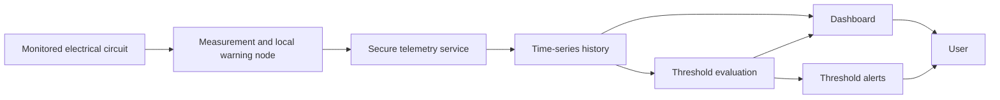

# Feature Specification: Intelligent Electrical Energy Monitoring System

**Feature Branch**: `001-energy-monitoring-system`

**Created**: 2026-10-14

**Status**: Draft

**Input**: Consolidate and revise the project definition contained in the six IoT laboratory documents under `docs/` into one coherent, testable project specification.

## Clarifications

### Session 2026-10-14

- Q: What deployment scope must the first working release support? → A: One controlled single-phase laboratory circuit or isolated test load; not for permanent installation.
- Q: Which electrical quantities must the first release measure and validate? → A: RMS voltage, RMS current, active power in W, and active energy in Wh/kWh.
- Q: Which analytics capabilities must be completed in the first release? → A: Threshold-based local and remote alerts only; anomaly detection, forecasting, and recommendations are later features.
- Q: Which acceptance-threshold profile should the first release be required to pass? → A: Balanced profile: 5% measurement error (superseded 2026-11-18: no reference meter, plausibility check only; see SC-001), 95% of updates within 10 seconds, 99% outage recovery, and local/remote alerts within 2/10 seconds.
- Q: How should the operator be allowed to access the first-release dashboard? → A: Only from a trusted local network; outbound remote threshold alerts are allowed.

### Session 2026-11-18

- Q: Must the prototype be built from new metrology-grade parts? → A: No. It is an educational demonstration built mostly from the team's available kit with minimal purchases; the calibrated range is narrowed to what that hardware supports (see plan › Hardware).
- Q: Should the node show readings locally? → A: Yes. The node shows its latest values and state on a local display and status light, and keeps doing so when the network is unavailable (FR-018).
- Q: Which parts are in the minimal MVP build? → A: Only those needed for measurement, local indication (status LED, buzzer, display, which the team already owns), safety, and calibration; non-essential extras (temperature logging, bench polarity source, dedicated protection panel) are left out (see plan › Hardware list).
- Q: Is a reference meter used? → A: No (constitution 2.0.0, Principle II). The team cannot afford a true-RMS reference meter, so the node runs on nominal (datasheet) coefficients plus offset zeroing and a polarity check; every displayed and published value is labeled as not validated, no accuracy figure is claimed, and readings are compared with load nameplates and the expected wall voltage only as a plausibility check.
- Q: What does "validated" mean in FR-001 and FR-006 now that readings are labeled "not validated"? → A: Renamed to "quality-checked (`valid`)": the summary passed the quality rules of the data model. "Not validated" refers only to the nominal calibration (no reference meter). (Session 2026-11-25, from `/speckit-analyze` finding A1.)
- Q: What circuit does the MVP demonstration monitor, given that no electrician or qualified reviewer is available? → A: A 12 V AC extra-low-voltage loop (plan B). A certified, thermally protected plug-in 220 V → 12 V AC adapter (≥ 2 A) feeds one 12 V halogen bulb (about 20 W) through the ACS712; the same adapter output feeds the voltage channel. Only the certified adapter touches the 220 V outlet, so the MVP has no mains wiring and needs no residual-current device, test box, fuse, or qualified-person review. Monitoring a 220 V load is future work and, if added, brings back the RCD, the closed ACS712 test box, and the signed qualified review (constitution I).

## User Scenarios & Testing *(mandatory)*

### User Story 1 - Monitor electrical consumption in real time (Priority: P1)

As an operator or evaluator, I want to see the current electrical behavior of a controlled test circuit so that I can understand how much energy it is using and notice unsafe or wasteful conditions.

**Why this priority**: Reliable measurement and visibility are the minimum useful product. Analytics, alerts, and recommendations have no value until trustworthy telemetry is available.

**Independent Test**: Connect the monitoring node to the controlled 12 V AC test loop, switch the known load on and off, and verify that the user can see RMS voltage, RMS current, active power, and accumulated active energy with timestamps and measurement-health information.

**Acceptance Scenarios**:

1. **Given** a calibrated node and an energized test load, **When** the load is switched on, **Then** the latest electrical measurements become visible to the user within 10 seconds.
2. **Given** a known load with a nameplate rating, **When** the load is switched on and later off, **Then** the displayed RMS current and active power rise to roughly the nameplate rating and fall back near zero.
3. **Given** an invalid or out-of-range sensor reading, **When** the system processes it, **Then** the reading is marked invalid and is not presented as trustworthy consumption data.

---

### User Story 2 - Review consumption history (Priority: P2)

As a user, I want to review consumption by hour, day, and week so that I can identify high-consumption periods and compare usage over time.

**Why this priority**: Historical visibility turns raw telemetry into actionable evidence and provides the data foundation required for anomaly detection and forecasting.

**Independent Test**: Load a representative set of timestamped measurements and verify that the user can select a time range, view trends, and identify the interval with the highest consumption.

**Acceptance Scenarios**:

1. **Given** at least one day of measurements, **When** the user selects an hourly or daily view, **Then** the system shows the corresponding active-power trend and accumulated active energy for that period.
2. **Given** a temporary communications outage, **When** connectivity returns, **Then** recoverable measurements are delivered without being silently duplicated or reordered.

---

### User Story 3 - Receive threshold alerts (Priority: P3)

As a user, I want to be warned when consumption is unusually high or exceeds a configured safety threshold so that I can inspect the connected equipment and reduce waste or risk.

**Why this priority**: Timely alerts are the first direct intervention the project provides and can be validated before advanced predictive models are available.

**Independent Test**: Configure an upper active-power threshold, introduce controlled loads below and above it, and verify local and remote alert behavior without relying on historical data.

**Acceptance Scenarios**:

1. **Given** a configured maximum active-power threshold, **When** the measured active power remains above it for the configured confirmation period, **Then** the system issues an alert identifying the circuit, time, measured value, threshold, and severity.
2. **Given** the remote service is unavailable, **When** a local threshold is exceeded, **Then** the monitoring node still presents a local warning.
3. **Given** a confirmed local threshold violation and healthy remote services, **When** the event is transmitted, **Then** the dashboard records it and the user receives a remote threshold alert.

### Session 2026-11-25

- Q: What should the node do when a load jumps beyond the calibrated current range, so every reading is `degraded` (out of range) and, under the "valid data only" rule, can never confirm a threshold breach? → A: A reading whose only quality problem is a current above the calibrated range, and whose active power is above the limit, counts as above the limit: it can confirm a breach and keep the warning on, but it never counts toward clearing. It still raises its data-quality event, is never stored or shown as a valid measurement, and any alert it causes carries quality `degraded`. Every other quality problem keeps the rule that it neither confirms nor clears (FR-012).

### Edge Cases

- The monitored circuit is de-energized or draws current below the measurable range.
- A sensor is disconnected, saturated, miscalibrated, or produces noisy readings.
- Voltage and current samples are incomplete or their timestamps cannot be trusted.
- The network, telemetry service, storage service, or dashboard becomes unavailable.
- An unauthorized or public-network client attempts to open the dashboard.
- The monitoring node restarts during an active-energy accumulation interval.
- Duplicate, late, or out-of-order measurements arrive after reconnection.
- Daylight-saving or timezone changes affect daily and weekly aggregation.
- A brief startup surge crosses a threshold but should not create a sustained-consumption alert.
- A load draws more current than the calibrated range, so its readings are out of range while it is clearly above the threshold.
- A user configures an unsafe, nonsensical, or unsupported threshold.

## Scope and System Context

The first release is a controlled, single-node prototype for one single-phase 12 V AC test loop with one isolated test load and is not intended for permanent installation. It demonstrates plausible (not validated) measurement, trusted-network visibility, historical analysis, and alerts before adding optional automation or environmental sensing.

**In scope for the first release**:

- One fixed monitoring node and one controlled single-phase 12 V AC test loop fed by a certified, thermally protected plug-in adapter, with one isolated test load.
- RMS voltage, RMS current, active power in W, active energy in Wh/kWh, timestamps, and measurement-health data.
- Near-real-time telemetry, durable time-series history, dashboard views, node-health status, and threshold alerts.
- Dashboard access restricted to the trusted local network, with outbound remote threshold notifications permitted.
- A local visible or audible warning for configured safety thresholds.
- A local display and status light on the node showing its latest readings and state.
- Plausibility evaluation against load nameplates and the expected wall voltage, with controlled load changes (no reference meter; no accuracy claim).

**Deferred until the monitoring MVP is validated**:

- Monitoring a 220 V mains load (requires a 30 mA RCD, the closed ACS712 test box, and a signed qualified-person review).
- Automatic disconnection or switching of mains-powered loads.
- Temperature and humidity sensing.
- Multi-node, multi-circuit, three-phase, or utility billing-grade operation.
- Apparent power, reactive power, and power-factor claims beyond what is required to validate active power and active energy.
- Historical anomaly detection, forecasting, and automated recommendations.
- Long-range radio connectivity and a dedicated mobile application.

## Requirements *(mandatory)*

### Functional Requirements

- **FR-001**: The system MUST acquire voltage and current observations from one monitored single-phase circuit at a rate sufficient to publish quality-checked (`valid`) RMS voltage, RMS current, and active-power summaries at least every 5 seconds.
- **FR-002**: Every published measurement MUST include a timestamp, node identity, circuit identity, units, and a validity or quality indication.
- **FR-003**: The system MUST calculate and report active power in watts and accumulated active energy in Wh or kWh from synchronized voltage and current observations using a documented phase-correction, calibration, and unit convention; multiplying independent RMS values alone MUST NOT be labeled active power.
- **FR-004**: The system MUST reject, flag, or quarantine disconnected, saturated, physically impossible, stale, or otherwise invalid observations.
- **FR-005**: The system MUST preserve active-energy accumulation across routine restarts and MUST clearly indicate any interval for which accumulation is uncertain.
- **FR-006**: The system MUST transmit quality-checked telemetry to the remote service and retry recoverable failures without silently duplicating measurements.
- **FR-007**: Device and service connections MUST be authenticated, telemetry in transit MUST be protected from unauthorized disclosure or alteration, and secrets MUST not be included in source-controlled files. The dashboard MUST accept access only from the trusted local network and MUST NOT be exposed directly to inbound public-internet traffic; outbound remote threshold notifications are permitted.
- **FR-008**: The system MUST retain at least 30 days of timestamped measurements for the prototype evaluation unless storage capacity is explicitly reconfigured.
- **FR-009**: Users MUST be able to see the latest RMS voltage, RMS current, active power, accumulated active energy, node status, and time of last valid update.
- **FR-010**: Users MUST be able to view and compare consumption over selectable hourly, daily, and weekly periods.
- **FR-011**: Users MUST be able to configure supported warning thresholds and a confirmation duration that prevents momentary startup surges from producing false sustained-consumption alerts.
- **FR-012**: The system MUST generate a local warning when a configured local threshold is confirmed, even when remote services are unavailable. A reading that is out of range only because its current is above the calibrated range, with active power above the limit, MUST count as above the limit for confirming and sustaining the warning, and MUST NOT count toward clearing it.
- **FR-013**: The system MUST generate a remote alert for confirmed threshold violations when remote services are healthy.
- **FR-014**: Every alert MUST state the affected node or circuit, event time, measured value, expected value or configured threshold, severity, and current status.
- **FR-015**: The system MUST distinguish normal, warning, invalid-measurement, offline, and insufficient-data states.
- **FR-016**: The first release MUST NOT perform automatic load disconnection; its responses are limited to local warnings, remote threshold alerts, dashboard status, and alert history.
- **FR-017**: The system MUST provide enough operational status information to determine whether failures originate at measurement, connectivity, ingestion, storage, threshold evaluation, or presentation stages.
- **FR-018**: The monitoring node MUST locally show its latest RMS voltage, RMS current, active power, and accumulated energy with units and quality, and its current state (normal, warning, invalid-measurement, offline, insufficient-data), including while remote services are unavailable; values that are not valid MUST NOT be shown as plain readings.

### Key Entities

- **Monitoring Node**: The fixed device associated with one monitored circuit; includes identity, status, configuration, calibration revision, and last-seen time.
- **Circuit**: The electrical load or single-phase circuit being observed; includes a human-readable name and applicable warning thresholds.
- **Measurement**: A timestamped set of RMS voltage, RMS current, and active-power values, including units, sequence information, calibration revision, and quality status.
- **Energy Total**: The accumulated active energy in Wh or kWh for a node and interval, including continuity or uncertainty status.
- **Threshold Configuration**: User-defined limits, confirmation duration, severity, and active period for a monitored circuit.
- **Alert**: A threshold, device-health, or data-quality event with evidence, severity, lifecycle status, and delivery time.

## Success Criteria *(mandatory)*

### Measurable Outcomes

- **SC-001**: With nominal calibration, on one stable resistive 12 V halogen load in the prototype test range, the displayed RMS voltage lies in the expected adapter range (10–16 V), active power is positive, and active power lies within the plausibility band of the load's nameplate rating (±20%, wider than a mains band because a halogen lamp's power follows the adapter's loaded voltage); with the load off, current falls to the absolute noise limit. Every value is labeled as not validated and no accuracy figure is claimed.
- **SC-002**: During a one-hour healthy-network test, at least 95% of scheduled summaries are visible to the user within 10 seconds of measurement and no accepted measurement is silently duplicated.
- **SC-003**: After a recoverable 10-minute communications interruption, at least 99% of locally retained measurements become available in correct chronological order within 5 minutes of reconnection.
- **SC-004**: Confirmed threshold violations produce a local warning within 2 seconds and a remote user-visible alert within 10 seconds when remote services are healthy.
- **SC-005**: A first-time user can identify the highest-consumption hour in a seven-day dataset in under 2 minutes without assistance.
- **SC-006**: All demonstrated readings and alerts expose their timestamp, unit, and current quality or status, with no unlabeled or misleading values in the acceptance review.

## Assumptions

- The initial deliverable is an academic prototype evaluated on one controlled single-phase 12 V AC test loop with one isolated test load; it is not approved for permanent installation, utility billing, or use as a production safety device.
- The MVP involves no mains wiring: only a certified, thermally protected plug-in adapter connects to the 220 V outlet, and everything the team wires is 12 V AC or less. Any future work involving mains voltage is assembled and reviewed by a qualified person using appropriate isolation, enclosure, residual-current and overcurrent protection, and safe test procedures.
- One 12 V halogen bulb (about 20 W) with a known nameplate rating is available for plausibility evaluation; no reference meter is available (constitution 2.0.0, Principle II).
- The installation has stable local power, indoor network coverage, and internet access during normal operation.
- The first release has one operator role and restricts dashboard access to the trusted local network; public dashboard access, multi-user access, billing, and tenant isolation are outside scope, while outbound remote threshold notifications are permitted.
- Thirty days is a practical initial retention period and may be adjusted after measuring storage usage.
- Threshold detection is the only consumption-alert method in the first release; historical anomaly detection, forecasting, and recommendations require separate future specifications after sufficient validated history exists.
- Environmental sensing and automatic load switching remain separate future features so that they do not block validation of the core monitoring path.
- The prototype is an educational demonstration built mostly from hardware the team already owns; it makes no accuracy claim, and its readings are labeled as not validated within the narrowed range stated in the plan.

